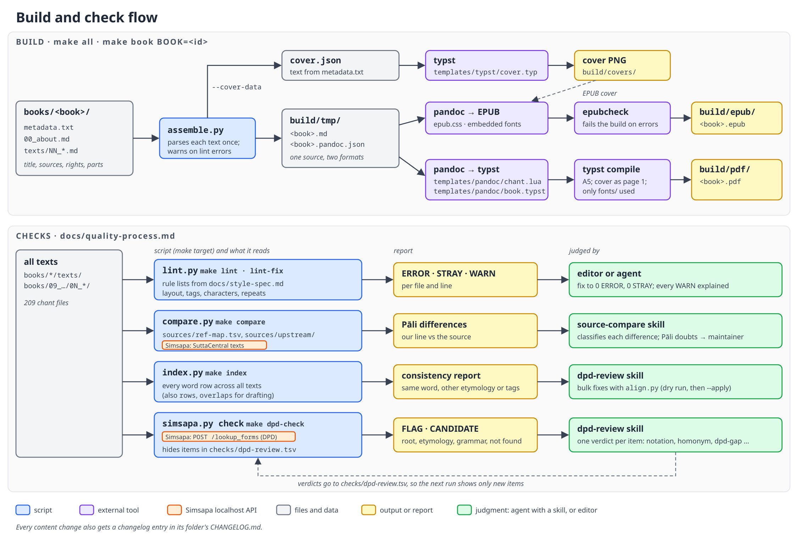
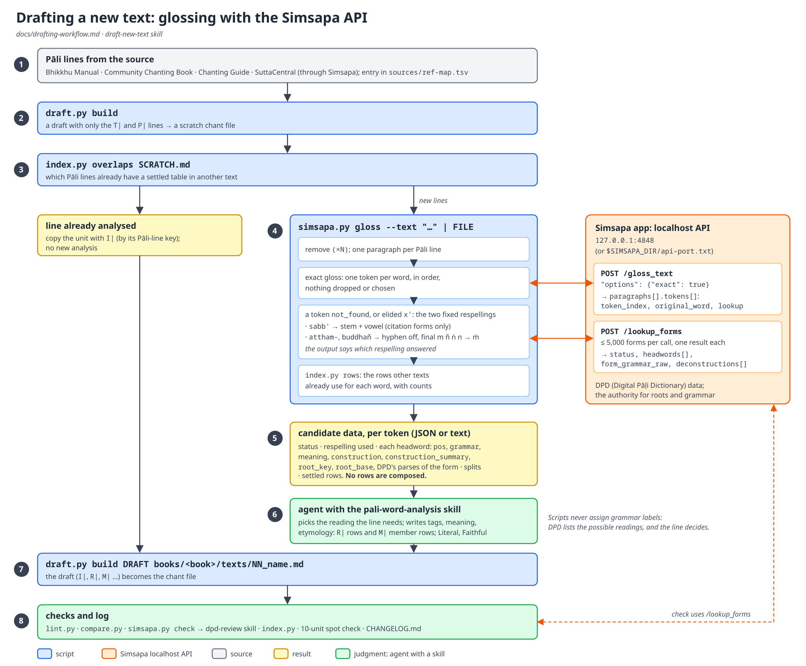

# Pāli Suttas and Chanting with Word-by-Word Analysis

Pāli chants and suttas for novice bhikkhus and anyone learning to chant with understanding. Each Pāli line is followed by a literal and a faithful English rendering, and by a table that analyses every word: its grammar, meaning and construction from its root. The Pāli comes from the *Bhikkhu Manual*, the *Chanting Guide* and SuttaCentral; roots and grammar are checked against the [Digital Pāḷi Dictionary](https://dpdict.net) (DPD).

The texts are built into 13 books, each as an EPUB and an A5 PDF:

| Book | Title | Texts |
| :--- | :--- | ---: |
| `01_morning_chanting` | Morning Chanting (*Pubbaṇha-vandanā*) | 7 |
| `02_evening_chanting` | Evening Chanting (*Sāyaṇha-vandanā*) | 9 |
| `03_reflections` | Reflections (*Paccavekkhaṇa-pāṭha*) | 21 |
| `04a_parittas` | Paritta: Protective Chants | 28 |
| `04b_verses_on_the_dhamma` | Verses on the Dhamma (*Dhamma-gāthā*) | 11 |
| `05_anumodanas` | Anumodanā: Blessings and Rejoicing in Merit | 14 |
| `06_funeral_chants` | Funeral Chants (*Matakicca-pāṭha*) | 10 |
| `07a_suttas` | Suttas (*Sutta-pāṭha*) | 12 |
| `07b_anagatabhaya_suttas` | Discourses on Future Dangers (*Anāgatabhaya-sutta*) | 6 |
| `07c_bhikkhuaparihaniyadhamma` | Conditions of Non-decline for Bhikkhus (*Bhikkhu-aparihāniya-dhamma*) | 7 |
| `08_patimokkha_chants` | Pāṭimokkha Chants (*Pāṭimokkha-pāṭha*) | 5 |
| `09_vinaya_formulae` | Vinaya Formulae (*Vinaya-pāṭha*), in five parts | 60 |
| `10_mahasatipatthanasutta` | The Great Discourse on the Establishments of Mindfulness (*Mahāsatipaṭṭhānasutta*, DN 22) | 19 |

The texts were made in an earlier project and migrated here; `docs/legacy-migration.md` tells that story.

## Workflows at a glance

How the books are built from `books/`, and how the checks and their reviews fit together:



How a new text is drafted: settled lines are reused, and the other lines are glossed through the Simsapa API, which gives DPD's data for each word; an agent then writes the rows with the `pali-word-analysis` skill:



The diagrams are drawn in `docs/images/*.svg`. After editing one, render it again with `rsvg-convert -z 1.5 -b white X.svg -o X.png && magick X.png -quality 90 X.jpg`.

## Folders

```text
books/<book>/        one folder per book
  metadata.txt       title, subtitle, language, sources, rights, text folders
  00_about.md        the book's "About This Book" page
  texts/             the chant files (NN_name.md) and the folder's CHANGELOG.md
books/09_vinaya_formulae/01_…–05_…/   the Vinaya book's five parts, instead of texts/
sources/             reference material for the checks, never built into a book
  UPSTREAM.txt       upstream sources and their pinned commits
  upstream/          clones made by `make fetch-sources` (not committed)
  originals/         the Vinaya and DN 22 source texts the legacy project worked from
  ref-map.tsv        which source passage each text is compared with
checks/
  dpd-review.tsv     reviewed DPD-check items, so a re-run shows only new ones
scripts/             Python tools (standard library only) and shell scripts
templates/           EPUB stylesheet, pandoc template and Lua filter, typst templates
fonts/               Crimson, Noto Sans, Noto Sans Math (SIL OFL)
docs/                style spec, decisions, workflows, build and Simsapa API notes
tests/               unit tests and their fixtures
.claude/skills/      skills for agents: word analysis, source compare, DPD review, drafting
tasks/               PRDs and task lists
build/               output (not committed)
```

## Required tools

| Tool | Version | Needed for |
| :--- | :--- | :--- |
| `pandoc` | ≥ 3.1.2 (first with the typst writer) | EPUB and PDF |
| `typst` | ≥ 0.13 | PDF and covers |
| `python3` | ≥ 3.11 | all scripts |
| `make`, `curl`, `git` | any | build, Simsapa checks, `fetch-sources` |
| `epubcheck` | any (needs Java) | validating every EPUB |
| `jq` | any | optional, for ad-hoc API queries |

Check them all, with install hints for your system:

```sh
make check-tools
```

Install:

```sh
# Arch Linux
sudo pacman -S pandoc-cli typst python make curl git jq
yay -S epubcheck            # AUR; or the jar from https://github.com/w3c/epubcheck/releases

# macOS (Homebrew)
brew install pandoc typst python make curl git epubcheck jq

# Debian / Ubuntu
sudo apt install python3 make curl git epubcheck jq
```

On Debian and Ubuntu the packaged pandoc is often too old (Debian 12 has 2.17): install the `.deb` from <https://github.com/jgm/pandoc/releases>. typst is not packaged there: use the binary from <https://github.com/typst/typst/releases>, or `cargo install --locked typst-cli`.

### Simsapa (for the DPD checks)

The word-table checks and lookups use the DPD data in the [Simsapa](https://github.com/simsapa/simsapa) app, through its localhost API. The books build without it; it is needed for `make dpd-check`, `scripts/simsapa.py lookup` and `gloss`, and the SuttaCentral texts of `make compare`. Version 1.1.0-alpha.2 or later is required.

1. Download Simsapa from <https://github.com/simsapa/simsapa/releases/> and start it. On the first run it downloads its database; after that it works offline.
2. The API starts with the app, on `127.0.0.1` port 4848 (or the next free port, written to `api-port.txt` in the app's data folder, e.g. `~/.local/share/simsapa/`). If it is not 4848, set `SIMSAPA_DIR` to that folder so the scripts find the port.
3. Confirm it answers:

   ```sh
   curl -s localhost:4848/health      # app_version, dpd_version, …
   make check-tools                   # also reports Simsapa and whether it is new enough
   ```

The API is described in `docs/simsapa-localhost-api-search-endpoints.md`.

## Usage

Plain `make` prints the list of targets.

| Command | Does |
| :--- | :--- |
| `make all` | builds every book: `build/epub/<book>.epub` and `build/pdf/<book>.pdf` |
| `make epub` / `make pdf` | all books in one format |
| `make book BOOK=01_morning_chanting` | one book, both formats |
| `make covers` | renders the generated covers (`build/covers/`) |
| `make epubcheck` | validates every built EPUB (each EPUB is also checked when it is built) |
| `make lint` / `make lint-fix` | checks every text against the style spec; `lint-fix` applies the safe fixes |
| `make fetch-sources` | clones or updates `sources/upstream/` at the pinned commits |
| `make compare` | compares each text's Pāli lines with its source (run `make fetch-sources` first; Simsapa must be running for the SuttaCentral texts, which are skipped and listed without it) |
| `make index` | cross-file consistency report (the same word analysed differently in two texts) |
| `make dpd-check` | checks every word row against DPD via Simsapa; fails on items not yet reviewed in `checks/dpd-review.tsv` |
| `make test` | runs the unit tests |
| `make clean` | removes `build/` |

A book is rebuilt when its texts, metadata, About page, the templates or the fonts change. A build warns, but does not stop, when lint finds errors in the book's texts. The pipeline is described in `docs/book-build.md`.

To change a book's title, sources or About page, edit `books/<book>/metadata.txt` or `00_about.md`; no code change is needed.

## Upstream sources

Recorded in `sources/UPSTREAM.txt`; used only for checks.

- *Bhikkhu Manual*, Reference Edition (Amaravati Publications, 2020): <https://github.com/bhikkhu-manual/bhikkhu-manual>, `manuscript/markdown/`. Fetched by `make fetch-sources`. CC BY-NC-ND 4.0.
- *Community Chanting Book*, English edition (Amaravati Publications, 2021): <https://github.com/profound-labs/community-chanting-book>, `chapters/english/markdown-vol1/`, `-vol2/`, `-satipatthana/`. Fetched by `make fetch-sources`. CC BY-NC-ND 4.0.
- *A Chanting Guide*, Ṭhānissaro Bhikkhu (Dhammayut Order in the USA, 4th ed. 2017): <https://www.dhammatalks.org/books/ChantingGuide/>, EPUB <https://www.dhammatalks.org/Archive/Writings/Ebooks/ChantingGuide210709.epub>. Not downloaded or committed; a local Markdown copy at `sources/upstream/chanting-guide-thanissaro.md` is optional, and without it `make compare` skips and lists the texts taken from it. CC BY-NC 4.0.
- SuttaCentral, Mahāsaṅgīti edition (<https://suttacentral.net>): read from the Simsapa app. Root texts CC0.

## Licence

- English renderings and word analyses: CC BY-NC 4.0. Free distribution only.
- Pāli text: under the licences of its sources (above).
- Fonts: SIL Open Font License 1.1 (`fonts/*/OFL.txt`).

Each book's `metadata.txt` states its sources and rights, and the books print them.

## For editors and agents

- `CLAUDE.md`: instructions for an agent working in this repo.
- `docs/style-spec.md`: the rules every text follows. Read it before editing a text.
- `docs/drafting-workflow.md`: how a new text is added.
- `docs/quality-process.md`: the checks every change goes through.
- `docs/decisions.md`: the maintainer's dated editorial decisions.
- `docs/book-build.md`, `docs/script-or-skill.md`, `docs/legacy-migration.md`: the build, the split between scripts and skills, and the migration from the legacy project.
